# Architecture

How the pieces of Bayt fit together when you run `./start.sh`.



Source: [`architecture.mmd`](architecture.mmd) (Mermaid). Edit that file and re-render the SVG and PNG; GitHub also renders Mermaid directly if you paste it into a ```` ```mermaid ```` fence.

## Services

| Service | Where it runs | What it does |
|---|---|---|
| `frontend/` (Next.js 16) | Your machine, `npx next dev` on port 3000 | Search and listing pages. Server components call the API over `BACKEND_URL`; the browser never talks to FastAPI directly. The browser does load photos from `cdn.realtor.ca` and basemap tiles from OpenFreeMap for the 3D lot view. |
| `backend` (FastAPI) | Docker, port 8000, source bind-mounted for reload | Listings API, City of Toronto data per listing, lot analysis, and zoning pathways (gap analysis against By-law 569-2013 plus the playbook in `backend/app/zoning/playbook/`). On start it runs `alembic upgrade head`, seeds an empty database from `backend/seed/*.json.gz`, and matches listings to city data if the `city` schema is loaded. |
| `db` (Postgres 17 + PostGIS) | Docker, host port 5433, `pgdata` volume | `public` schema (owned by Alembic): `listings`, `listing_city_data`, `lot_analyses`, `listing_investment`, `zoning_answers`. `city` schema (owned by the importer): parcels, zoning layers, address points, permits, heritage, Committee of Adjustment applications (`coa_raw` from the importer, `coa_applications` typed and geocoded by `app.city.coa`). |
| `importer` (GDAL) | Docker, `tools` profile, run on demand | Downloads Toronto Open Data packages into `data/city/` (cached by the city's `last_modified`) and loads them with `ogr2ogr` into the `city` schema. |

## External calls

| From | To | When |
|---|---|---|
| backend | City of Toronto GIS (ArcGIS REST) | Lot analysis: 6 to 8 queries per lot for the parcel, neighbours, building footprints, zoning, lot coverage, sixplex permission and centrelines. Results are cached in `lot_analyses` for 30 days. `./start.sh lot-analysis` fills the cache for every Toronto listing. |
| backend | A model API: Nebius Token Factory (OpenAI-style HTTP, NVIDIA Nemotron models), or NVIDIA NIM / OpenRouter / Anthropic | Optional, with `LLM_API_KEY`: 2 structured-output calls per new zoning question; 1 per listing for the house profile and the photo labels; 1 per listing page and persona for the similar-homes rerank; embeddings for the pitches. Provider picked from the key prefix. All cached in Postgres. |
| importer | Toronto Open Data (CKAN) | `./start.sh city-data`, then the backend runs `app.city.match` to link listings to addresses, lots and zoning, and `app.city.coa` to place Committee of Adjustment applications on address points. |
| browser | `cdn.realtor.ca` | Listing photos through `next/image`. |
| browser | OpenFreeMap | Vector tiles under the MapLibre 3D lot scene. |

## Entry point

`start.sh` is the only thing you run. It brings up `db` and `backend` with `docker compose up --wait`, then starts the Next.js dev server in the foreground. Its subcommands run the importer, the lot-analysis backfill, migrations and tests inside the containers. See `./start.sh help`.
