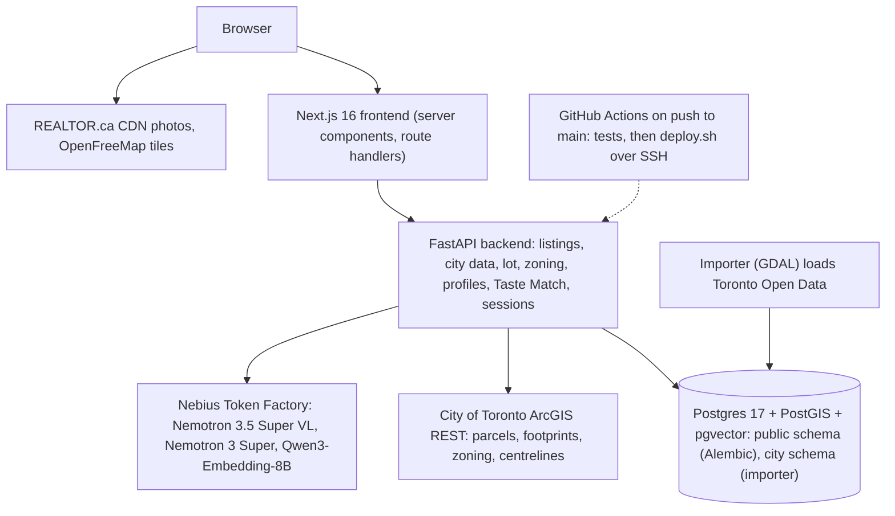
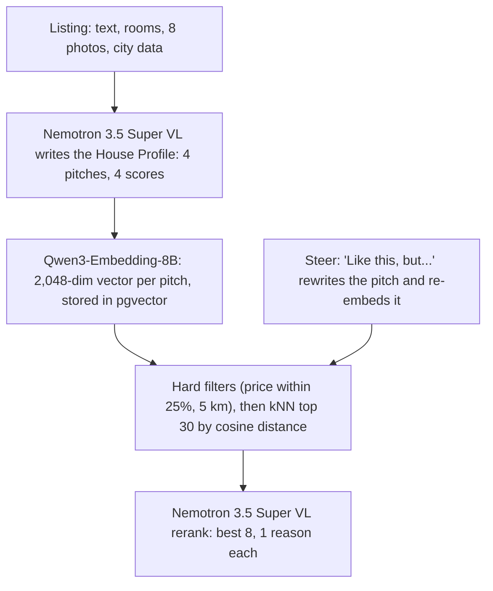
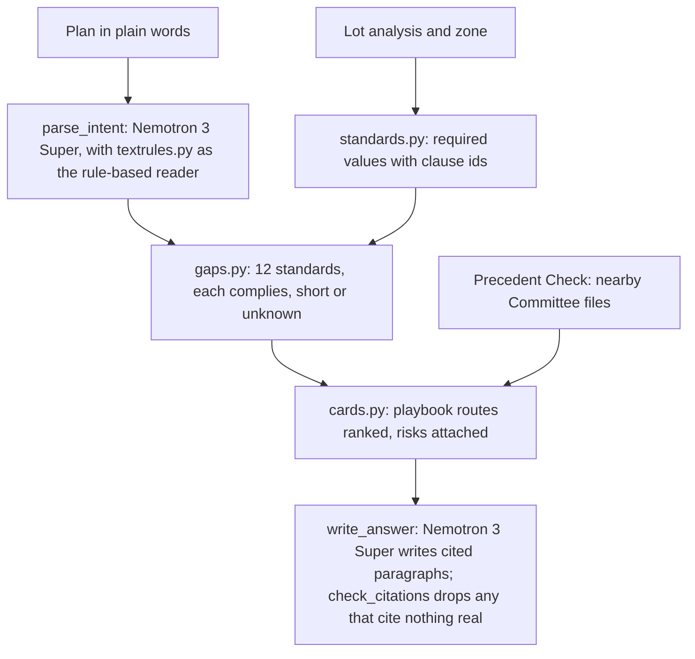

# About this report

- **Title:** Bayt: Search by taste, not by filters. How the pipelines work.
- **Authors:** Shareq Rabbani, Shafeeq Rabbani, Khaja Kamil
- **Date:** 30 October 2026
- **Live site:** https://bayt.andalsolutions.com
- **Repository:** https://github.com/shafeeqr2/bayt (MIT licence)
- **Submission:** Nebius x NVIDIA Global AI Hackathon, track Best Apps and Agents

This report describes how Bayt works, pipeline by pipeline, for the judges of the Nebius x NVIDIA Global AI Hackathon. Every number comes from the repository's documentation, its tests, or measurements made on 30 October 2026. File paths in parentheses point at the code that implements each part.

Product names used throughout: **Taste Match** (similar homes, the "More like this" page and the "Like this, but…" box), **Build Check** (the "What could you build here?" zoning question), **Precedent Check** (the Committee of Adjustment analysis), **Floor Sketch** (the "Possible layout" drawing) and **Taste Profile** (the per-session summary of what a visitor likes).

# 1. Summary

Bayt is a real estate search for Toronto, live with 2,261 listings. The problem it addresses is the question a realtor hears most: "I want a home similar to this one." Filters on price, bedrooms and bathrooms cannot answer it, because what a buyer likes lives in the photos, the lot, the layout and the condition.

The idea follows the shift Netflix made from click-based recommendation to a language model that reads what a title is about. In Bayt, a language model reads every listing the way a buyer would and writes a House Profile: a fact layer plus a pitch and a score for 4 kinds of buyer (first-time buyer, investor, flipper, builder). Search then runs on those pitches, not on filters.

The 5 features:

1. **Taste Match.** 8 homes in the same price band within 5 km, ranked for the buyer you are, with 1 reason each. "Like this, but…" steers the search in words.
2. **Taste Profile.** Saves and dismissals in a session become a 1-line summary and a buyer guess that sets the site's default buyer. No login.
3. **Build Check.** A plan in plain words checked against Toronto Zoning By-law 569-2013 for the exact lot, with the public routes for each shortfall and a cited answer.
4. **Precedent Check.** Every Committee of Adjustment decision since 2001 within 500 m of the home, with outcomes and the approval rate.
5. **Floor Sketch.** The listed rooms fitted into the City's building outline, level by level, completed with rooms the description names.

Key numbers:

| Measure | Value |
|---|---|
| Listings live | 2,261 |
| Buyer types scored per listing | 4 |
| Matches per Taste Match answer | 8, with 1 reason each |
| Committee files within 500 m of 39 Rhydwen Avenue | 222 (188 approved, 9 refused) |
| Time and cost to profile the catalogue | 78 minutes, about $8 |
| Backend tests, no network calls | 319 |
| Licence | MIT |

Every model call runs on Nebius Token Factory with NVIDIA Nemotron models, plus one embedding model.

# 2. Architecture

## 2.1 Components

| Component | Technology | Role |
|---|---|---|
| Frontend | Next.js 16, App Router, Tailwind (`frontend/`) | Server components render every page. The browser never calls FastAPI directly. |
| Backend | FastAPI, SQLAlchemy 2, Alembic (`backend/app/`) | Listings, city data, lot analysis, zoning, profiles, similar homes, sessions. |
| Database | Postgres 17 with PostGIS and pgvector (`db/Dockerfile`) | `public` schema owned by Alembic; `city` schema owned by the importer. |
| Importer | GDAL `ogr2ogr` container (`importer/`) | Loads about 1 GB of City of Toronto open data into the `city` schema. |
| Edge | Caddy 2 (`deploy/Caddyfile`) | TLS, routes `/api/*` to FastAPI except the Next route handlers. |
| Hosting | Docker Compose on 1 DigitalOcean droplet (`docker-compose.prod.yml`) | 2 vCPU, 4 GB, Ubuntu 24.04. |
| Deploy | GitHub Actions (`.github/workflows/deploy.yml`) | Tests, then SSH to the server and `deploy/deploy.sh`. |
| Models | Nebius Token Factory, OpenAI-style API (`backend/app/zoning/answer.py`) | All language, vision and embedding calls. |

*Figure 1. The services and the external systems they call. Caddy sits in front of the frontend and the backend in production (`docs/architecture.mmd`, `deploy/Caddyfile`).*

## 2.2 Request flow for a listing page

1. The browser requests `/listings/{id}`. Next.js renders the page on the server and fetches `GET /api/listings/{id}` and the stored photo labels over `BACKEND_URL`.
2. The page streams in sections. Each section is a server component inside a `Suspense` boundary with its own backend call: city data, lot analysis, Floor Sketch, Precedent Check.
3. A visit never triggers a model call for profiles or photo labels. Those are written ahead of time by backfill jobs and cached in Postgres. Taste Match, Build Check and Floor Sketch room completion call the model on first use and cache the answer.
4. The browser loads photos from REALTOR.ca's CDN through `next/image` and basemap tiles from OpenFreeMap for the 3D lot view.

# 3. Data

## 3.1 Listings

`backend/seed/*.json.gz` holds REALTOR.ca listing exports made with an Apify scraper. On an empty database the backend seeds them (`backend/app/seed.py`): price, type, rooms with level and size, description, photo URLs and the full source payload in a `raw` column. Photos are not copied; the database keeps the CDN URLs. The data is for evaluation only; the MIT licence covers the code.

## 3.2 City of Toronto open data

`./start.sh city-data` runs the importer, then `app.city.match` and `app.city.coa` (`backend/app/city/`).

| Table (`city` schema) | Source dataset | Rows |
|---|---|---|
| `address_points` | Address Points (Municipal) | about 525,000 |
| `parcels` | Property Boundaries | about 500,000 |
| `buildings` | Building Outlines with LiDAR heights | about 558,000 |
| `zoning_area` and overlays | Zoning By-law 569-2013 layers | about 17,000 |
| `heritage` | Heritage Register | about 12,000 |
| `permits_*` | Building Permits | about 1,100,000 |
| `coa_applications` | Committee of Adjustment Applications since 2001 | 94,527 (88,816 placed) |

`app.city.match` links each listing to the city in 4 steps: the address point with the same number and street nearest the pin (or the nearest within 40 m); the parcel containing it; the zone at a point inside the lot; permits by address point id. Every Toronto listing with a usable address (1,855) matches an address and a lot. About 30% have no zone because their sites, mostly condo buildings, fall outside By-law 569-2013.

## 3.3 Caches and versions

Model output and slow analyses are stored once and reused.

| Table | Holds | Refresh rule |
|---|---|---|
| `listing_profiles` | House Profile facts, model, prompt version, note | Rewritten when `PROMPT_VERSION` changes |
| `listing_persona_profiles` | 4 rows per listing: score, pitch, signals, concerns, 2,048-dim embedding, embedding model | Same as above; re-embedded when the embedding model changes |
| `similar_results` | Taste Match answers and steering rewrites by request hash | 24 hours |
| `lot_analyses` | Lot analysis result as JSON | 30 days |
| `listing_city_data` | Address, parcel, zone, heritage, permits per listing | Rebuilt by `city-data` |
| `listing_photos` | 1 row per photo: facts, model, prompt version, note | Rewritten when the photo URL or prompt changes |
| `floor_plan_hints` | Rooms the model read for Floor Sketch | Rewritten when `PROMPT_VERSION` changes |
| `zoning_answers` | Build Check answers by intent hash | Keyed by playbook version, prompt version and model |
| `session_events`, `session_taste` | Opens, saves, dismissals; the taste summary | Per session cookie, 1 year |

A failed model call stores the reason in the row's `note` with the payload null, so the next backfill tries that listing again.

# 4. The House Profile pipeline

The profile is written once per listing by `backend/app/similar/profile.py` and is the input to everything in Taste Match.

## 4.1 Inputs

- The listing facts, the description and the room list with levels and sizes.
- The price against the median for the same building type in the community, or the city when the community has fewer than 5 such listings.
- The city data row (zone, height limit, parcel size, heritage) and the lot analysis verdicts (severance, garden suite, coverage, as-of-right units) when present.
- The investment estimate (`backend/app/strategy/estimate.py`): rent from the listing or TRREB averages, operating costs, gross yield, cap rate, suite evidence.
- The photo labels when the listing has them; otherwise up to 8 photos as JPEG data URLs resized to 800 px on the long side, about 1 MB per call and 674 tokens per image.

## 4.2 Output schema

The model returns one JSON object validated by pydantic (`Profile`): a `Facts` block and 4 `PersonaView` blocks.

| Facts field | Meaning |
|---|---|
| `era`, `style`, `layout` | Decade built, building form, how the main floor flows |
| `kitchen_finish`, `bath_finish` | 1 original or worn to 5 high-end recent renovation |
| `overall_condition`, `renovation_era` | 1 needs major work to 5 like new; when the finishes date from |
| `basement`, `basement_suite`, `separate_entrance` | finished to none; legal unit, apartment, kitchenette or none; outside door |
| `outdoor`, `light`, `summary` | Yard and garage in 1 line; light in 12 words; 3 to 5 plain sentences |

Each `PersonaView` has a score from 1 to 10, a pitch of 3 to 5 sentences in that buyer's words, 3 to 6 signals and 0 to 3 concerns. Null means the sources did not say; the prompt forbids inventing a year, a count or a feature.

## 4.3 The 4 rubrics

The rubric for each persona names what the buyer cares about and what the score bands mean (`RUBRICS` in `profile.py`).

| Persona | A 9 or 10 looks like | A 1 or 2 looks like |
|---|---|---|
| First-time buyer | Updated throughout, a layout that works, sound building, no cost surprises | Needs major work, a tear-down, or a cost far out of line for a first buyer |
| Investor | 2 or more rentable units today, or a cap rate well above the area, with a path to more | A thin yield with no way to add a door, or costs that eat the rent |
| Flipper | Clearly dated inside, sound bones, priced below the area, on a street where renovated homes sell far higher | Fully renovated at the top of the area, a condo with nothing to change, or a tear-down |
| Builder | Severance likely, or a wide deep lot with garden suite room and multiplex zoning, nothing heritage | A condo apartment, a heritage property, or a lot already built to its limit |

Most of the project's iteration went into these rubrics rather than the model choice.

## 4.4 The model call

- Model: `nvidia/Nemotron-3.5-Super-VL` on Nebius Token Factory. 1 call per listing, about 6 seconds with 8 photos.
- Mode: plain JSON (`response_format: json_object`) with the schema in the system prompt. The grammar-constrained schema mode stalls the vision model on enum fields.
- Thinking: off, through `chat_template_kwargs: {"enable_thinking": false}`. With the default on, the model spent the whole output budget on hidden reasoning and returned empty content.
- Budget: 3,000 output tokens.

## 4.5 Guards

- **Location and price scrub.** The prompt forbids the address, the street, the neighbourhood and the dollar price in a pitch or a signal. `clean()` scrubs them anyway and clamps scores to 1 to 10. This keeps location and price out of the embedding, so "similar" means similar for the buyer's reasons and not "same street".
- **Comma-string repair.** About 1 call in 100 returned `signals` or `concerns` as one comma-separated string. A validator splits it instead of failing the listing.
- **Retry.** A call that drops the connection is retried once. A failure stores the reason in `note`.

## 4.6 Backfill

`./start.sh profiles` (`backend/app/similar/backfill.py`) profiles every listing with parallel workers (8 on the production run, 4 by default), Toronto houses first, then townhouses, then condos. The full run on Token Factory wrote 2,260 of 2,261 profiles in 78 minutes for about $8, then embedded 9,044 persona pitches in 3.5 minutes. The remaining listing fails schema validation on every try and is left for a prompt fix. When 20 listings fail in a row the job stops instead of retrying against a host that is not answering.

# 5. Taste Match

`GET /api/listings/{id}/similar?persona=&steer=&facets=` (`backend/app/similar/service.py`, `steer.py`, `embed.py`).

*Figure 2. From a listing to 8 ranked matches. Steering replaces the query vector; filters stay outside the vector.*

## 5.1 Embeddings

Each persona pitch plus its signals is embedded with `Qwen/Qwen3-Embedding-8B` on Token Factory, asked for 2,048 of its 4,096 dimensions. The vector is stored in `listing_persona_profiles.embedding` next to the model name. Requests carry 200 texts each. If the configured embedding model differs from the stored one, the service refuses to compare vectors and asks for a re-embed.

## 5.2 Hard filters and nearest neighbours

The candidates are the same persona's rows with a current embedding, priced within 25% of the source and within 5 km of it. Under 5 candidates, the radius is dropped, then the price band; the answer lists the filters that held. Cosine distance to the source pitch picks 30 candidates. With a few thousand rows this is an exact scan in milliseconds; an HNSW index is planned for 50,000 rows.

## 5.3 Rerank with reasons

One call to `nvidia/Nemotron-3.5-Super-VL` receives the source's pitch, signals and concerns and the 30 candidates' pitches, signals, lot size and parking. It returns the best 8 in order, 1 reason line each of at most 22 words, facts only, and 1 line on what sets the source apart. Ids the model invents are dropped. Without a model, or when the call fails, the answer is the nearest-neighbour order with the shared signals as the reason.

The answer is cached in `similar_results` for 24 hours, keyed by a hash of the persona, the candidate ids, the steering and the model. A new profile in the neighbourhood changes the hash and makes a new answer.

## 5.4 Steering: "Like this, but…"

The buyer types up to 200 characters. One model call rewrites the source's persona pitch with the change applied: the pitch of the house the buyer is asking for, same voice and length, scrubbed like a stored pitch. That text is embedded with the catalogue's model and the nearest-neighbour search runs from the new vector. The rerank sees the rewritten target and the ask as a constraint, so candidates that deliver it rank first and their reason says how. The rewrite and its vector are cached for 24 hours. A steered page costs 3 calls the first time and none after. "Bigger backyard and a garage" moves the list because lots and parking are in the facts; "closer to the subway" does not, because no profile knows where the subway is.

## 5.5 Facets

5 chips, all on by default: layout, finish, lot, location, money. A chip that is off tells the rerank what to ignore. Two facets are also hard filters: location off removes the 5 km radius, money off removes the 25% price band. At least 1 chip stays on; an unknown facet is a 422.

## 5.6 The page

`/listings/{id}/similar` (`frontend/app/listings/[id]/similar/page.tsx`) shows the source house, a 2 by 2 buyer switch with this house's score per buyer, the steering box, the facet chips and the pitch on the left, and the ranked list on the right: rank, photo, price, facts, address, the reason and the score. Every tile on the site carries a button that opens this page for that house. The state lives in the URL, so the page is a server component.

## 5.7 Relation to the Netflix recommender

Netflix's public engineering writing describes a move from models driven by interaction signals toward foundation models that read the content of titles and members' histories. Bayt borrows the first half of that shift: a language model reads each listing and writes down why 4 kinds of buyer would want it, and retrieval runs on that text. Bayt does not train a model on interaction data; its only behavioural signal is the session-level Taste Profile in section 6. The claim is the analogy, not parity.

# 6. Taste Profile

`backend/app/taste/service.py`, with Next route handlers under `frontend/app/api/session/`.

- **Session.** The first visit sets an httpOnly cookie `bayt_sid` (32 hex characters, 1 year, SameSite lax) from a Next route handler. The browser never sees the backend.
- **Events.** Every open, save, unsave and dismiss posts 1 event to `POST /api/session/{sid}/events` with `via` (similar, search, direct, saved) and the buyer in view. A session holds at most 2,000 events.
- **The summary.** After every 5th event the backend makes 1 structured call to `nvidia/nemotron-3-super-120b-a12b` with the last 20 events, each with the house's facts, its 4 scores and the best persona's pitch. The answer is 1 or 2 sentences addressed to "you", a persona guess, a confidence from 0 to 1 and 3 to 5 "likes". It is stored in `session_taste`; failures go to `note` and never reach the visitor.
- **Default buyer.** `GET /api/session/{sid}` returns the saves, the taste and `default_persona`: the guess when the confidence is 0.7 or more. The search, listing and Taste Match pages use it when the URL names no buyer and say so in 1 line. A buyer in the URL always wins.
- **Metric.** `GET /api/metrics/similar` reports, of the sessions with at least 1 save, the share whose saved house was first opened from the Taste Match page in that session. It is a replay of the event table.
- **Privacy.** No login, no name, no email. The cookie is a random id. Events reference listing ids only.

# 7. Lot analysis

`backend/app/lot/analysis.py`, `service.py`, `toronto.py`. Toronto only.

1. **Parcel.** 6 to 8 queries to the City of Toronto's ArcGIS REST services fetch the parcel containing the listing's point (or the nearest within 15 m), neighbouring parcels, building footprints, zoning, the lot coverage overlay, sixplex permission and street centrelines. Everything is computed in metres in EPSG:2952. Queries are POSTed because the city's firewall rejects long GET URLs.
2. **Frontage and depth.** Boundary segments not shared with a neighbour are open edges; open edges along a centreline are street lines; the front lot line is the shorter street line on a corner lot. Frontage is measured the way the by-law does, 6 m back from the street. Depth is the extent perpendicular to the front.
3. **Coverage.** Footprints clipped to the parcel, overlaps unioned, slivers under 2 m² dropped, main building and ancillary split by the city's subtype. Reported against the zoning cap (33% in a typical RD zone, 45% for a houseplex) with the remaining buildable footprint.
4. **Envelope.** The main building's front, side and rear setbacks, length, depth, width and LiDAR height. Build Check uses these as the existing values.
5. **Zoning.** Zone label, minimum frontage and area, as-of-right units (4 since the 2023 multiplex by-law, 6 where the Sixplex Permission layer applies).
6. **Verdicts.** Severance: split the lot side by side and test each half against the minimums and the prevailing frontage within 100 m. Garden suite (Chapter 150.7): the buildable box after a 5.0 m separation, 1.5 m rear setback, side setbacks and footprint caps, with flags for a missing 1.0 m side path or a laneway. Verdicts are `likely`, `possible`, `unlikely`, `not_applicable` or `unknown`.

Results are cached in `lot_analyses` for 30 days; `./start.sh lot-analysis` fills the cache for every Toronto listing. On the page, the lot is drawn to scale with the footprints, the front lot line and the rear yard, and a 3D view extrudes the house and its neighbours to LiDAR heights with the zoning height limit as a translucent slab.

Validation on the 724 Toronto houses in the seed: every coordinate landed in or within 20 m of a parcel; the median ratio of parcel area to the listed lot size was 1.00; 629 of 722 were within 15%; measured frontage agreed within 1 m on about 85% of regular lots.

# 8. Build Check

`backend/app/zoning/` answers 2 questions for 1 Toronto parcel and 1 proposal: which standards is the proposal short on and by how much, and which legal pathways address each shortfall.

*Figure 3. The deterministic analysis in the middle; the model reads words in and words out, never a rule.*

## 8.1 Reading the plan

`parse_intent` turns the person's words into the same fields as the form: project type, keep the walls or not, units, storeys, height, floor area, footprint, setbacks. The model fills a field only when the text says it; a value outside the bounds is dropped. Under it, `textrules.py` reads the common phrases ("third storey", "10.5 m high", "rear yard of 6.5 m", feet converted) and fills any field the model left empty. It is the only reader when no key is set. Detail fields typed in the form win over the text.

## 8.2 The deterministic analysis

`standards.py` resolves the required value of 12 standards for the zone with the clause ids they rest on: lot frontage, lot area, lot coverage, height, storeys, building depth, building length, floor space index, front, side and rear setbacks, units. Numbers come from Chapter 10 of By-law 569-2013 (sections 10.5 to 10.80). `gaps.py` compares required, proposed and existing and marks each `complies`, `short`, `unknown` or `not_applicable`. Zones outside R, RD, RS, RT and RM return `unknown`; a site-specific exception flags every row. The multiplex rule since May 2023 allows up to 4 units as of right in these zones.

## 8.3 Routes and risks

A playbook card (`backend/app/zoning/playbook/*.yaml`) names a route: legal non-conforming use, as-of-right, minor variance at the Committee of Adjustment, consent to sever, rezoning, appeal, or a constraint. Each card has a trigger over the fact paths, the standards it covers, its legal basis with URLs, the mechanics, mandatory risks, buyer questions, professional notes, cost and time bands, and the Committee work types to pull as precedents. Loading fails on a card with no risk or no legal basis. Ranking gives 10 points per short standard the card covers, 5 for a fully true trigger, minus a cost penalty; constraints get 8 extra so they sit near the top.

## 8.4 The cited answer

`write_answer` gives `nvidia/nemotron-3-super-120b-a12b` a compact view of the analysis: the gaps, the ranked cards with their legal basis, risks and questions, and the nearby Committee files, each with an id (`gap:<standard>`, `card:<id>`, `clause:<clause>`, `file:<reference>`, `files:all`). The call runs at medium effort with thinking off; the schema and the ids do the constraining. The model returns a headline, sections of paragraphs with citations, questions and unknowns. `check_citations` keeps a paragraph only when every citation resolves to an id in the analysis; a paragraph with no citation, a made-up clause or an unknown file is dropped and listed. The model can only word what the analysis holds. Smaller models were tried and rejected: Nemotron 3 Nano invented fields in the parse; Nemotron 3.5 Lightning wrote 1 thin section with citations in the prose.

Answers are cached in `zoning_answers` by listing and a hash of the intent fields, the playbook version, the prompt version and the model. The text is not part of the key, so 2 wordings of the same plan cost 1 call. A new question takes about 5 seconds; a repeated plan under 1 second. The page also draws the plan as a schematic model: the lot, the planned box, the most the by-law allows, and 1 dimension line per standard in green, orange or grey.

# 9. Precedent Check

`backend/app/city/coa.py` loads the data; `backend/app/zoning/precedents.py` queries it.

- **Source.** Toronto Open Data's Committee of Adjustment Applications: an active file, a closed file since 2017 and 1 closed file per year back to 2001. Each record has the address, zone label, work type, description, hearing date, the committee's decision, any board decision and a status. It has no variance table and no coordinates.
- **Placing files.** 1 row per application (a decided row beats an undecided one), dates parsed in 3 formats, the decision normalised from more than 40 raw spellings to approved, approved with conditions, approved in part, refused, withdrawn, deferred, pending or unknown. Appeals to the OMB or TLAB are read into `appeal` and `appeal_body`; the board's result wins over the committee's in `outcome`. A point comes from the city address points by normalised street name and number, exact first and range second. On 24 October 2026: 94,527 applications, 88,816 placed (94%).
- **Search.** `nearby()` returns every file within a radius, default 500 m and at most 2,000 m, nearest first, with optional work type and keyword filters. `summarize()` counts outcomes and the approval rate, approved divided by decided. Around 39 Rhydwen Avenue: 222 files, 188 approved, 9 refused, 95% approval.
- **Feeding Build Check.** `for_card()` picks the files a route calls comparable by work type (R Addition, New R Building, Sever Lot) or by keyword (garden suite, laneway suite, fourplex). The analysis gains 4 facts a trigger may read and each candidate route shows up to 5 decided examples. The written answer may cite them as `file:<reference>`.
- **The honest limit.** The city publishes decisions and descriptions, not the variance tables; the hearing notices that hold them stay online for about 90 days. So a precedent is "what the file asked for, in the city's words, and what was decided". An approval nearby is precedent, not a promise, and the answer says so.

On the listing page the section is a closed card that shows the counts while closed and the nearest 15 files when opened.

# 10. Floor Sketch

`backend/app/lot/floorplan.py` fits the listed rooms into the City's building outline; `backend/app/lot/rooms.py` completes the room list with the model.

## 10.1 Placement

- The main footprint is turned so its walls run along the grid with the street side at y = 0, using the frontage line from the lot analysis. The outline is rasterised on a 10 cm grid.
- Rooms are placed one at a time at the best-scoring free position, scored for every position at once with summed-area tables. Roles pull rooms front to back (living room at the front, kitchen and family room at the back), reward exterior walls for bedrooms, and reward pairs such as kitchen beside dining. 16 room orders are tried per level and the best layout kept, so the result is deterministic.
- One straight stair is placed in the same spot on every level where it lets the most rooms fit; bathrooms missing from the table come from the bathroom count; an attached garage is placed at the front when the parking type says so.
- A room up to 15% larger than the space is drawn smaller and flagged.

## 10.2 Filling the plan

An audit of 41 Toronto houses (122 levels) on 30 October 2026 found the plans a median 57% full and 13% of levels under 30% full. Three fixes:

1. Rooms listed with no size are drawn at a typical size for their kind and marked `size_assumed`.
2. A level above the main floor whose outline is more than 1.3 times the listed interior size divided by the above-grade levels is cut from the back, keeping the front wall, to 1.1 times that. A 1.5-storey or loft read by the model cuts the top level too.
3. One structured call to `nvidia/nemotron-3-super-120b-a12b` reads the room table, the counts, the description and the photo labels and returns the rooms they name that the table lacks, each with a typical size and a quote as evidence. `clean()` maps the model's level names to the 4 drawn levels, drops echoes of listed rooms and clamps sizes. The answer is cached in `floor_plan_hints`.

After the deterministic fixes the same 122 levels are a median 63% full and 4% under 30%. With the model's rooms, the main floor of 3 Indianola Drive goes from 74% to 84%. What stays a guess: room positions, the stair, and levels the listing mislabels.

# 11. Photo labels

`backend/app/photos/reader.py` and `sheet.py`.

- **The vision pass.** One structured call per photo to `nvidia/Nemotron-3.5-Super-VL` returns the kind (front, back, side, street, aerial, interior, floor plan, other), a title, a 1-sentence caption about the house, the level, the listed room it shows, window count and wall, exterior doors, stairs, rooms it is open to, storeys and the garage side. The reader sends the bytes as a JPEG data URL at most 1,280 px wide, because a host given the URL may serve a stale copy.
- **Furniture filter.** The prompt separates what stays with the house from what leaves. A caption that still names furniture is asked for once more with the words to leave out.
- **The review pass.** One photo at a time gets the floor wrong about 1 time in 10. `review_labels()` sends every label and a contact sheet of numbered thumbnails to the vision model, 5 runs in parallel; a fix counts when 3 runs agree, and a level change must pass a colour-histogram check against the photos that look most like it. The pass runs 2 rounds.
- **Where the labels go.** Under the gallery and in the lightbox; into the House Profile instead of raw photos; into Floor Sketch room completion as "what the vision model saw"; and a `floor_plan` kind is guarded by a light-pixel check so a drone photo is never taken for a drawing.

Measured on 25 October 2026: 1 to 2 seconds and about $0.0004 per photo; 50 photos in 8.4 seconds for about $0.02.

# 12. Models and Token Factory

## 12.1 Every model call

| Job | Model | Calls and cache |
|---|---|---|
| House Profile | `nvidia/Nemotron-3.5-Super-VL` | 1 per listing, about 6 s, stored |
| Taste Match rerank | `nvidia/Nemotron-3.5-Super-VL` | 1 per house and buyer, 24 h cache |
| Steering rewrite | `nvidia/Nemotron-3.5-Super-VL` | 1 per typed ask, 24 h cache |
| Photo labels and review | `nvidia/Nemotron-3.5-Super-VL` | 1 per photo plus 5 per listing, stored |
| Build Check parse and answer | `nvidia/nemotron-3-super-120b-a12b` | 2 per new question, cached by intent |
| Floor Sketch room completion | `nvidia/nemotron-3-super-120b-a12b` | 1 per listing, stored |
| Taste Profile | `nvidia/nemotron-3-super-120b-a12b` | 1 per 5 actions, stored |
| Embeddings | `Qwen/Qwen3-Embedding-8B`, 2,048 dims | 200 pitches per request, stored |

## 12.2 Why each model

- **Nemotron 3.5 Super VL** is 1 vision-language model that follows a strict JSON schema and reads 8 photos with 2,000 tokens of listing text in about 6 seconds. It writes the profiles, the reasons and the photo labels, so the same model voice runs through the product. The whole catalogue was profiled in 78 minutes for about $8, which made re-running after each prompt change affordable.
- **Nemotron 3 Super (120B mixture of experts, 12B active)** reasons over long by-law text at a low price per token. Thinking stays off for every call today, including the cited zoning answer, which keeps answers at about 5 seconds; the backend turns it on at high effort when a call needs it. Smaller Nemotron models were tried on the same lot and rejected for invented fields and thin answers.
- **Qwen3-Embedding-8B** is the only embedding model Token Factory serves. The live model list queried on 30 October 2026 returned 29 models and 1 embedder. A Nemotron embedder would be the first swap when one is listed.

## 12.3 Working with Token Factory

- One OpenAI-style endpoint for chat, vision and embeddings. The provider is picked from the key prefix (`v1.` for Token Factory); the same code runs on NVIDIA NIM or OpenRouter.
- The thinking switch is `chat_template_kwargs: {"enable_thinking": <bool>}` in the request body. It is set from the call's effort level.
- Rate limits start at 60 requests per minute and grew with use; the `x-ratelimit-*` headers and `Retry-After` paced the backfill.
- Cost: about $0.004 per listing with 8 photos; the full catalogue about $8; a Build Check question well under 1 cent.
- Connections: the backend's database pool is 20 plus 30 overflow with a 10-second timeout, and the slow model calls release their database connection before calling the model. An earlier 5 plus 10 pool was exhausted by sessions held across model calls.

# 13. Quality and testing

- **Tests.** 319 backend tests collected on 30 October 2026, all with fake clients and no network calls: the profile prompt blocks, scrub and clamp, the embedding client, the rerank id guard, the steering parser and facet tiers, the floor plan placement and the new fills, room completion clean-up, the zoning predicates, standards and pathways, the citation check, the Committee normalisation, and the taste trigger and threshold. The GitHub Actions `test` job runs them on every push.
- **Hand-check gates in the plan.** Gate 1 (50 profiles read by hand, rubric fixed), gate 2 (100 pair judgments from 2 people, 70% agreement with the top 5) and gate 3 (10 steering trials, 9 move the asked way) are defined in `docs/similar-homes-plan.md`. They were spot-checked during the build and have not been run at full size.
- **Known limits.** Room positions and the stair in Floor Sketch are guesses. A listing that labels a bungalow bedroom "Third level" is drawn as labelled. Condo units get no lot analysis because the parcel covers the whole corporation. Typed asks about transit, schools or walk scores do nothing until a data source exists. Site-specific zoning exceptions are flagged, not interpreted. Building outlines refresh quarterly, so a new build can lag.

# 14. Deployment

- One DigitalOcean droplet (2 vCPU, 4 GB, Ubuntu 24.04) runs 4 containers with Docker Compose: Caddy, the Next.js standalone frontend, FastAPI and Postgres 17 with PostGIS and pgvector.
- Caddy terminates TLS with Let's Encrypt, sends the Next route handlers (`/api/pins`, `/api/session`, the zoning proxies) to the frontend and the rest of `/api/*` to FastAPI.
- Every push to `main` runs `.github/workflows/deploy.yml`: the test job, then an SSH step as the `deploy` user that runs `deploy/deploy.sh`. The script fetches `origin/main` with a read-only deploy key, builds the images, starts the services, waits for the backend health check and runs `alembic upgrade head`. A concurrency group serialises pushes.
- Rollback is a revert and a push. Secrets and the model key live in `/opt/bayt/.env`, never in git.

# 15. What's next

- Transit, schools and walk data in the House Profile, so location asks in steering work.
- Read the listing's own floor-plan photo with Nemotron VL when one exists, and use window walls and stairs from the photo labels to constrain room positions.
- Run the 3 hand-check gates at full size and keep the judgment set in the repo as a fixture.
- More municipalities behind the same lot interface; Peel, York and Durham publish similar open data.

# Appendix A: API endpoints

| Method and path | Purpose |
|---|---|
| `GET /api/listings` | Search with filters, sort and paging; `sort=fit` orders by a persona score |
| `GET /api/listings/facets` | Cities and building types |
| `GET /api/listings/map` | Every match as a map pin |
| `GET /api/listings/{id}` | One listing |
| `GET /api/listings/{id}/city` | Address, lot, zone, heritage, permits |
| `GET /api/listings/{id}/lot` | Lot analysis, cached 30 days |
| `GET /api/lot?lat=&lon=` | Lot analysis for any Toronto point |
| `GET /api/listings/{id}/floorplan` | Floor Sketch |
| `GET /api/listings/{id}/photos` | Stored photo labels |
| `POST /api/listings/{id}/photos/read` | Read the photos with the vision model |
| `POST /api/listings/{id}/photos/review` | The review pass |
| `GET /api/listings/{id}/profile` | The House Profile |
| `POST /api/listings/{id}/profile` | Write the House Profile |
| `GET /api/listings/{id}/similar` | Taste Match: `persona`, `steer`, `facets` |
| `GET /api/listings/{id}/investment` | Rent, costs, yield, cap rate, value-add flags |
| `GET /api/strategy/defaults`, `GET /api/strategy/parse` | Financing defaults; a strategy in words |
| `POST /api/listings/{id}/zoning/pathways` | Deterministic Build Check from form fields |
| `POST /api/zoning/pathways?lat=&lon=` | The same for any point |
| `POST /api/listings/{id}/zoning/ask` | Build Check from plain words with the cited answer |
| `GET /api/listings/{id}/zoning/precedents` | Precedent Check, `radius_m`, `work_type`, `q` |
| `GET /api/zoning/precedents?lat=&lon=` | The same for any point |
| `GET /api/zoning/playbook` | Every route card |
| `GET /api/tiles/buildings/{z}/{x}/{y}` | Vector tiles of city building outlines |
| `GET /api/city/boundary` | City limits |
| `POST /api/session/{sid}/events` | Record an open, save, unsave or dismiss |
| `GET /api/session/{sid}` | Saves, taste and the default buyer |
| `GET /api/metrics/similar` | Share of saving sessions that found the home through Taste Match |
| `GET /api/health` | Health check |

# Appendix B: Environment variables

| Variable | Meaning |
|---|---|
| `LLM_API_KEY` | The model key. The prefix picks the provider: `v1.` Token Factory, `nvapi-` NVIDIA NIM, `sk-or-` OpenRouter, `sk-ant-` Anthropic. |
| `LLM_PROVIDER`, `LLM_BASE_URL` | Force a provider or point at any OpenAI-style endpoint |
| `ZONING_MODEL` | Text model for Build Check, room completion and Taste Profile; empty means `nvidia/nemotron-3-super-120b-a12b` |
| `PHOTO_MODEL` | Vision model for photo labels; empty means `nvidia/Nemotron-3.5-Super-VL` |
| `PROFILE_MODEL` | Model for the House Profile, rerank and steering; empty means `nvidia/Nemotron-3.5-Super-VL` |
| `EMBED_MODEL` | Embedding model; empty means `Qwen/Qwen3-Embedding-8B` |
| `DATABASE_URL` | Postgres connection string |
| `CORS_ORIGINS` | Allowed origins; the live site in production |
| `POSTGRES_PORT`, `BACKEND_PORT`, `FRONTEND_PORT` | Local ports for `./start.sh` |
| `UVICORN_RELOAD` | `0` in production disables the file watcher |
