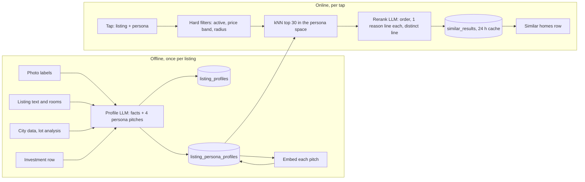
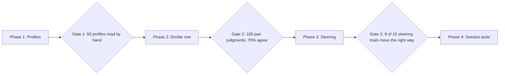

# Similar Homes Plan

2026-10-28 · Shafeeq Rabbani, with Claude

Source: the Claude Docs version at https://claude.ai/artifact/TE2j5ZxRp91wHNo8P6HSMq

As built on 2026-10-28 (phases 1 and 2, see `docs/similar-homes.md`), 3 details differ from this plan:

- The embedding is 2048 floats, not 1024. The free NVIDIA model `nvidia/nemotron-3.5-embed-1b:free` returns 2048.
- There are 3 new tables, not 2. `similar_results` holds the 24 h rerank cache.
- Only NVIDIA models are used, on the free OpenRouter listings. The profile and rerank model is `nvidia/nemotron-3.5-super-vl:free`.

## Goal

A buyer opens a listing and taps "more like this". Bayt returns 5 to 10 houses that are similar for the reason this buyer cares about, with 1 line per result that says why.

The same house appeals to a first-time buyer, an investor, a flipper, and a builder for different reasons. So "similar" has no single meaning. The system scores each house once per buyer persona. The buyer picks the persona, or Bayt infers it from the session.

Bayt can win here for 2 reasons:

- Bayt already labels every listing photo with a vision model and checks the labels in a second pass. That output is the raw material for a house profile.
- Bayt computes lot geometry, zoning pathways, and Committee of Adjustment precedents per parcel. No listing portal can rank by development potential. The builder and investor personas depend on it.

The approach follows the shift from filter and collaborative recommenders to language-model recommenders, as Netflix made in 2025 and 2026. Content goes in as text. A model does the ranking and the explanation.

Scope for this plan: Toronto only, active listings only, both buyer mode and professional mode.

## Personas

Start with 4 personas. Each one has a different definition of similar, a different set of facts that matter, and a different language for the explanation line.

| Persona | What similar means | Facts that drive the score | Explanation voice |
| --- | --- | --- | --- |
| First-time buyer | Same life in it for 5 years | Move-in condition, monthly cost incl. tax and fees, commute, schools, parks, street character, parking | "Move-in ready, same commute, similar monthly cost" |
| Investor | Same income and risk profile | Rent per door, legal basement, separate entrance, cap rate, tenant demand, suite potential, as-of-right units | "2 doors, 5.1% cap, same rent band" |
| Flipper | Same spread between buy and sell | Price below area median, dated finishes, good bones, layout faults that are cheap to fix, permit history, resale ceiling in the area | "Dated kitchen, solid structure, $180k below area median" |
| Builder or heavy renovator | Same lot and zoning potential | Lot width and depth, severance, as-of-right GFA, laneway and garden suite eligibility, heritage status, CoA precedents nearby | "28 ft lot, laneway eligible, 2 variances granted on the street" |

Rules:

- A house belongs to every persona at once, with 1 score per persona from 1 to 10. A house with 9 for investor and 3 for first-time buyer is a normal result.
- The user picks the persona with a visible control. Inference from the session is a fallback, never the only path.
- Keep the count at 4 for the first release. More buckets dilute the labelled data and make the toggle harder to read.
- Buyer mode shows first-time buyer by default. Professional mode shows investor by default.

## House profile

Each listing gets 1 profile with 2 layers. The fact layer is shared. The persona layer is written 4 times, once per persona.

**Fact layer** (1 per listing, structured JSON, written once by the LLM from all sources):

| Field group | Fields | Source |
| --- | --- | --- |
| Building | era, style, storeys, construction type, roof, exterior material | Photo labels, listing text |
| Layout | layout type, open plan or closed, main floor rooms, bedroom split by level, bathroom count by level | Photo labels, rooms list |
| Condition | kitchen finish level 1 to 5, bath finish level 1 to 5, floors, windows, mechanical, overall condition 1 to 5, renovation era | Photo labels, listing text |
| Basement | finished, ceiling height hint, separate entrance evidence, kitchen present, legal suite claim | Photo labels, listing text, investment row |
| Outdoor | yard size class, deck or patio, garage position, laneway access | Photo labels, lot geometry |
| Lot and zoning | frontage m, depth m, area m2, zone string, height limit, as-of-right units, severance verdict, garden suite verdict, heritage status | ListingCityData, LotAnalysisCache, ListingInvestment |
| Location | community, nearest subway or GO station, walk score class, school zone | Listing, city data |
| Money | price, price vs community median, tax, monthly cost estimate, rent estimate, cap rate | Listing, ListingInvestment, strategy.estimate |

**Persona layer** (4 per listing):

| Field | Type | Purpose |
| --- | --- | --- |
| `persona` | enum of 4 | Which lens |
| `score` | integer 1 to 10 | Fit for this persona |
| `pitch` | 3 to 5 sentences | What this persona cares about in this house, in that persona's words |
| `signals` | list of short strings | The 3 to 6 facts that drove the score, for the explanation line |
| `embedding` | vector of 1024 floats | Nearest-neighbour search inside the persona space |
| `model`, `prompt_version`, `computed_at` | provenance | Same pattern as `listing_photos` |

Storage: 2 new tables, `listing_profiles` (fact layer) and `listing_persona_profiles` (persona layer), both keyed by listing id, both JSONB plus a few indexed columns. Embeddings go in a `vector` column. The database is Postgres 17 with PostGIS and no vector extension yet. Add pgvector to the `db` image. At 2,300 listings an exact search is fast enough and needs no index. Add an HNSW index when the count passes 50,000.

The pitch is the text that gets embedded, not the fact JSON. A pitch written for investors puts rent and doors first, so 2 houses with the same income profile sit close in the investor space even when they look nothing alike.

## Pipeline

The expensive work runs once per listing. A tap runs 1 SQL query and 1 LLM call.

The profile LLM writes the fact layer and the 4 persona pitches in 1 call. The embeddings land in Postgres. A tap filters, pulls the 30 nearest in the chosen persona space, and sends them to 1 rerank call that also writes the reason lines.

**Profile writing.** Input is the photo labels with captions, the listing description and rooms, the city data row, the lot analysis result, and the investment row. Output is 1 JSON object with the fact layer and 4 persona blocks. The prompt holds a rubric per persona so scores mean the same thing across listings. Run it on import, and again when photos or price change. Reuse the provider setup from the zoning answer: Anthropic, OpenRouter, or NVIDIA NIM by key prefix.

**Embedding.** Embed the pitch, not the JSON. Use 1 embedding model for all 4 personas so the vectors are comparable. Pick a hosted model with a 1024 dimension output. Store the model name next to the vector so a model change triggers a re-embed.

**Retrieval.** Hard filters first: active, price inside a band around the source house, inside a radius or the same community. Then cosine distance in the persona column. Return 30. With 2,300 listings this is an exact scan in a few ms. Keep a fallback with no filters so a rural or unusual house still gets neighbours.

**Rerank and explain.** 1 call. Input: the source house's persona pitch and signals, the 30 candidates' pitches and signals, the persona rubric, and the session taste summary when there is one. Output: an ordered list of up to 10 ids, 1 reason line each, and 1 line that says what makes the source house distinct. Cache the result by source id, persona, and filter hash for 24 hours. The rerank is the Netflix-style part. The retrieval stage keeps it cheap.

**Latency budget.** The zoning answer runs in about 5 s on the fastest host. The rerank is a shorter prompt with a shorter answer. Target under 2 s. Show the kNN order at once and swap in the reranked order when it arrives, so the page never waits.

## Steering and session taste

The buyer can say what to change. The system also learns from what the buyer does. Both feed the rerank call, not a new model.

**Steering by text.** The results panel has 1 text box: "like this, but...". Examples: "bigger backyard", "same kitchen, any neighbourhood", "closer to the subway". The LLM rewrites the source pitch with the change applied and runs retrieval again from the rewritten text. The rerank call gets the original request as a constraint. This reuses the plain-text parser pattern from the strategy search.

**Facet chips.** Under the text box, 5 chips: layout, finish, lot, location, money. The buyer turns a chip off to drop that facet from the comparison. The rerank prompt lists the active facets. No new embeddings are needed for this.

**Session taste.** Store opens, saves, and dismissals per session, no login needed. After every 5 actions, 1 LLM call writes a 3-sentence taste summary and a persona guess with a confidence. Examples: "Opens houses with basement apartments and separate entrances. Skips condos. Likely investor." The summary goes into the rerank prompt. The persona guess sets the default toggle when confidence passes 0.7 and the buyer has not picked one.

**What this is not.** No collaborative filtering, no training on click data, no user vectors. At Bayt's scale those methods have nothing to learn from. The LLM reads the session as text. This can be replaced later with a trained ranker once there is enough traffic.

## Product surface

The feature appears in 3 places. The listing page is the first release.

| Place | What shows | Mode |
| --- | --- | --- |
| Listing page, below the gallery | A "Similar homes" row of 5 to 10 cards. A persona toggle above the row. 1 reason line under each card. A "like this, but..." box and 5 facet chips. | Buyer and professional |
| Listing page, header | A persona score badge: "Investor 8/10" or "First-time buyer 7/10", with the 3 top signals on hover | Buyer and professional |
| Search results | A "more like this" link on each card that opens the listing page with the row scrolled into view | Buyer and professional |

Mode rules:

- Buyer mode defaults to the first-time buyer persona and hides the investor numbers behind the toggle.
- Professional mode defaults to the investor persona, shows all 4 scores in the badge, and shows the signals in full.
- The reason line always names facts, never adjectives. "Same 25 ft lot, laneway eligible, kitchen renovated" is right. "Great potential" is rejected by the prompt rubric.

Empty states:

- A listing with no profile yet shows the row with a "preparing" note and triggers the profile job. The row fills on refresh.
- Fewer than 3 results inside the filters: drop the area filter, then the price band, and say so in 1 line above the row.

The row ships as a server component on the listing page and calls 1 new endpoint, `GET /api/listings/{id}/similar`, with `persona`, `steer`, and `facets` as query parameters.

## Fit with the current codebase

Most of the inputs exist. The new work is 1 backend package, 2 tables, 1 endpoint, and 1 frontend row.

| Part | Status | Where it lives |
| --- | --- | --- |
| Photo labels with titles, captions, and facts, checked in a second pass | Exists | `backend/app/photos`, table `listing_photos` |
| Lot geometry, frontage, depth, severance and garden suite verdicts | Exists | `backend/app/lot`, table `lot_analysis_cache` |
| Zoning facts, pathways, CoA precedents | Exists | `backend/app/zoning`, table `listing_city_data` |
| Rent estimate, cap rate, suite evidence, as-of-right units | Exists | `backend/app/strategy`, table `listing_investment` |
| LLM provider switch by key prefix, JSON mode, prompt versioning | Exists | `backend/app/zoning/answer.py`, `backend/app/config.py` |
| Plain-text intent parser | Exists | `backend/app/strategy/parse.py` |
| Vector column and nearest-neighbour query | New | pgvector in `db/Dockerfile`, 1 Alembic migration |
| Profile writer with persona rubrics | New | `backend/app/similar/profile.py` |
| Embedding client | New | `backend/app/similar/embed.py` |
| Retrieval, rerank, cache | New | `backend/app/similar/service.py` |
| Session taste summary | New | `backend/app/similar/taste.py`, table `sessions` |
| Similar homes row, persona toggle, steering box | New | `frontend/app/listings/[id]/similar-row.tsx` |
| Score badge on the listing header and search cards | New | `frontend/app/listing-card.tsx`, listing page header |

The profile job follows the photo read job: a POST endpoint per listing for manual runs, and a backfill command in the same style as `backend/app/lot/backfill.py` for all 2,300 seed listings. The importer calls it on new or changed listings.

The product brief lists investors and home buyers as the first 2 users. The persona layer answers the brief's open question about which user to target first: both, with a toggle.

## Phases

Build the profiles first. Every later phase reads them and adds nothing to the data model.

Each gate is a check a person does by hand before the next phase starts. Durations below are estimates for 1 developer.

**Phase 1: Profiles. About 2 weeks.**

- [x] Add pgvector to the `db` image and 1 migration for `listing_profiles` and `listing_persona_profiles`
- [x] Write the profile prompt with the fact schema and 4 persona rubrics, versioned like the photo prompt
- [x] Add the embedding client with the model name stored next to each vector
- [x] Add `POST /api/listings/{id}/profile` and a backfill command for the 2,300 seed listings
- [ ] Gate: read 50 profiles by hand, fix the rubric until the scores match the reader's view

**Phase 2: Similar row. About 2 weeks.**

- [x] Add `GET /api/listings/{id}/similar` with persona, filters, kNN top 30, rerank, and a 24 hour cache
- [x] Render the row on the listing page with the persona toggle and 1 reason line per card
- [ ] Show the kNN order at once and swap in the reranked order when it arrives
- [ ] Gate: 100 pair judgments from 2 people, at least 70% agree with the top 5

**Phase 3: Steering. About 1 week.**

- [x] "Like this, but..." text box that rewrites the pitch and re-runs retrieval
- [x] 5 facet chips passed to the rerank prompt
- [x] Score badge on the listing header and the search cards, with the search card link
- [ ] Gate: 10 steering trials, the results change in the asked direction in 9

**Phase 4: Session taste. About 1 week.**

- [ ] Session store for opens, saves, and dismissals without login
- [ ] Taste summary call after every 5 actions, with a persona guess and confidence
- [ ] Default toggle set from the guess above 0.7 confidence
- [ ] Live metric: share of sessions that save a house reached through the similar row

## Evaluation

Measure the profiles, the ranking, and the product effect as 3 separate things. A good ranking on bad profiles is not possible, so the order matters.

| Layer | Method | Pass mark | When |
| --- | --- | --- | --- |
| Profile facts | 50 listings read by hand against the photos and text, 1 error count per field group | Under 1 wrong fact per profile on average | Gate 1, then 20 listings per month |
| Persona scores | 2 people score the same 50 listings per persona on the rubric | Within 2 points of the model on 80% of scores | Gate 1 |
| Similar ranking | 100 source houses, 2 judges each pick the 5 best of the 30 kNN candidates per persona | At least 70% overlap between the model's top 5 and the judges' picks | Gate 2, then after every prompt change |
| Reason lines | Judges mark each line as fact, vague, or wrong | 90% fact, 0% wrong | Gate 2 |
| Steering | 10 trials with a typed change, judge says whether the results moved the asked way | 9 of 10 | Gate 3 |
| Product effect | Share of sessions that save a house reached through the similar row, and clicks per row shown | Trend over 4 weeks, no fixed mark at launch | Phase 4 onward |

Keep the judgment set in the repo as a fixture. Every prompt or model change re-runs the ranking test offline before it ships. This is the same discipline as the trial listings in the photo labels work.

## Risks, costs, and open questions

**Risks and the response:**

| Risk | Effect | Response |
| --- | --- | --- |
| The vision labels invent a fact and the profile repeats it | A wrong reason line destroys trust fast | Profile prompt may only use facts present in the labels and text. The 50-profile hand check at gate 1 counts invented facts. |
| Price and location dominate the embedding | Every result is "same street, same price" | Hard filters take price and area out of the vector. The pitch leaves the address out. |
| Persona scores drift between runs | The badge changes on refresh | Temperature 0, versioned rubric, store the score and never recompute without a version change. |
| Rerank latency on a slow host | The row feels broken | Show the kNN order first. Cache 24 hours. Cap the prompt at 30 candidates. |
| Stale profiles after a price or photo change | The investor score is wrong after a price cut | The importer marks changed listings. The profile job re-runs on price, photo, or status change. |
| 4 personas are the wrong 4 | Buyers do not find themselves in the toggle | The rubric is a prompt, not code. Add or rename a persona with a backfill, no schema change. |

**Costs per 1,000 listings, estimated:**

| Item | Calls | Note |
| --- | --- | --- |
| Profile writing | 1,000 | 1 call each, about 3,000 tokens in and 1,500 out. Runs once. |
| Embeddings | 4,000 | 1 per persona pitch. Cheap. |
| Rerank | 1 per tap, cached | Scales with traffic, not listings. |
| Taste summary | 1 per 5 actions | Scales with traffic. |

At 2,300 listings the backfill is 1 evening of API time on any of the 3 providers already wired in.

**Open questions:**

- [ ] Which embedding model: a hosted one from the same provider as the text model, or a separate vendor? Decide at phase 1.
- [ ] Does the first-time buyer persona need a monthly cost input to be useful, or is the price band enough?
- [ ] Should the flipper persona read permit history from the city data now, or wait for the renovation estimate feature in the product brief?
- [ ] Session storage without login: cookie id in Postgres, or browser only? Browser only loses the taste summary across devices.
